# ambientCG: Wood materials

**17 assets from [ambientCG](https://ambientcg.com), dedicated to the public domain under [CC0](https://docs.ambientcg.com/license/).** Use them in any game, free or paid, and change them however you like; no credit is needed.

PBR materials as 1K and 2K JPG maps (colour, normal GL and DX, roughness, AO, displacement), one folder per resolution. 409.9 MB in all.

This is a copy kept by [zuujis-cc0](https://github.com/zuujis-cc0) so game makers can take single files from GitHub. It is not made by or affiliated with ambientCG: the originals, often in more formats and higher resolutions, are on [ambientcg.com](https://ambientcg.com). If they help you, consider [supporting ambientCG](https://www.patreon.com/ambientCG).

Every file is listed in [MANIFEST.tsv](MANIFEST.tsv) with its size and SHA-256. More free assets: [the Zuujis collection](https://github.com/zuujis-cc0/free-game-assets#readme).

| | | | |
| :-: | :-: | :-: | :-: |
| <a href="Wood085B">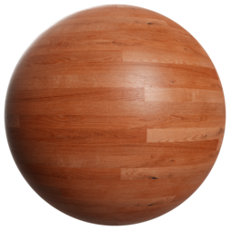</a> <b><a href="Wood085B">Wood 085 B</a></b> by ambientCG · <a href="https://ambientcg.com/a/Wood085B">source</a> | <a href="Wood086">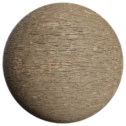</a> <b><a href="Wood086">Wood 086</a></b> by ambientCG · <a href="https://ambientcg.com/a/Wood086">source</a> | <a href="Wood087">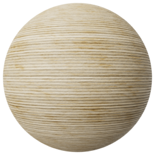</a> <b><a href="Wood087">Wood 087</a></b> by ambientCG · <a href="https://ambientcg.com/a/Wood087">source</a> | <a href="Wood088">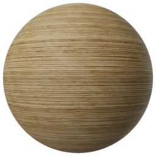</a> <b><a href="Wood088">Wood 088</a></b> by ambientCG · <a href="https://ambientcg.com/a/Wood088">source</a> |
| <a href="Wood089">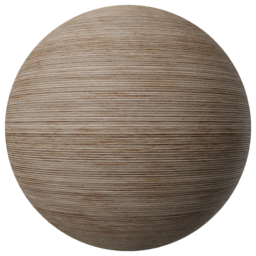</a> <b><a href="Wood089">Wood 089</a></b> by ambientCG · <a href="https://ambientcg.com/a/Wood089">source</a> | <a href="Wood090A">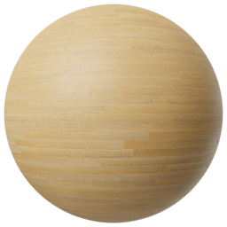</a> <b><a href="Wood090A">Wood 090 A</a></b> by ambientCG · <a href="https://ambientcg.com/a/Wood090A">source</a> | <a href="Wood090B">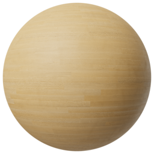</a> <b><a href="Wood090B">Wood 090 B</a></b> by ambientCG · <a href="https://ambientcg.com/a/Wood090B">source</a> | <a href="Wood091A">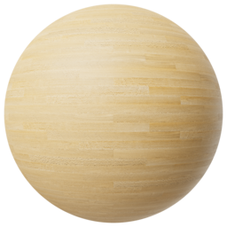</a> <b><a href="Wood091A">Wood 091 A</a></b> by ambientCG · <a href="https://ambientcg.com/a/Wood091A">source</a> |
| <a href="Wood091B">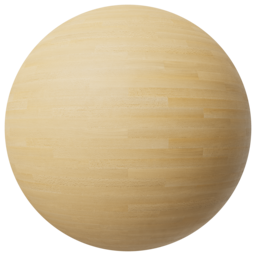</a> <b><a href="Wood091B">Wood 091 B</a></b> by ambientCG · <a href="https://ambientcg.com/a/Wood091B">source</a> | <a href="Wood092">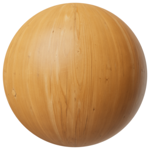</a> <b><a href="Wood092">Wood 092</a></b> by ambientCG · <a href="https://ambientcg.com/a/Wood092">source</a> | <a href="Wood093">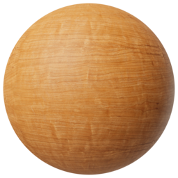</a> <b><a href="Wood093">Wood 093</a></b> by ambientCG · <a href="https://ambientcg.com/a/Wood093">source</a> | <a href="Wood094">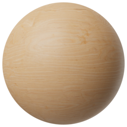</a> <b><a href="Wood094">Wood 094</a></b> by ambientCG · <a href="https://ambientcg.com/a/Wood094">source</a> |
| <a href="Wood095">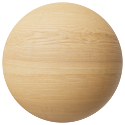</a> <b><a href="Wood095">Wood 095</a></b> by ambientCG · <a href="https://ambientcg.com/a/Wood095">source</a> | <a href="Wood096">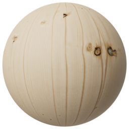</a> <b><a href="Wood096">Wood 096</a></b> by ambientCG · <a href="https://ambientcg.com/a/Wood096">source</a> | <a href="Wood097">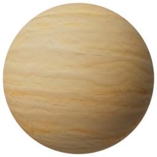</a> <b><a href="Wood097">Wood 097</a></b> by ambientCG · <a href="https://ambientcg.com/a/Wood097">source</a> | <a href="Wood098">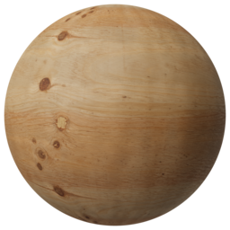</a> <b><a href="Wood098">Wood 098</a></b> by ambientCG · <a href="https://ambientcg.com/a/Wood098">source</a> |
| <a href="Wood099">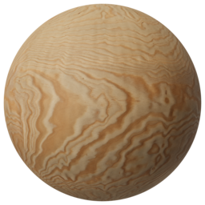</a> <b><a href="Wood099">Wood 099</a></b> by ambientCG · <a href="https://ambientcg.com/a/Wood099">source</a> |  |  |  |

---

Kept up to date by this repository's own [update workflow](.github/workflows/update.yml), with code and plan from [cc0-mirror](https://github.com/zuujis-cc0/cc0-mirror). Something wrong? [Open an issue there](https://github.com/zuujis-cc0/cc0-mirror/issues/new) or use the [private report form](https://games.zuujis.com/report).
